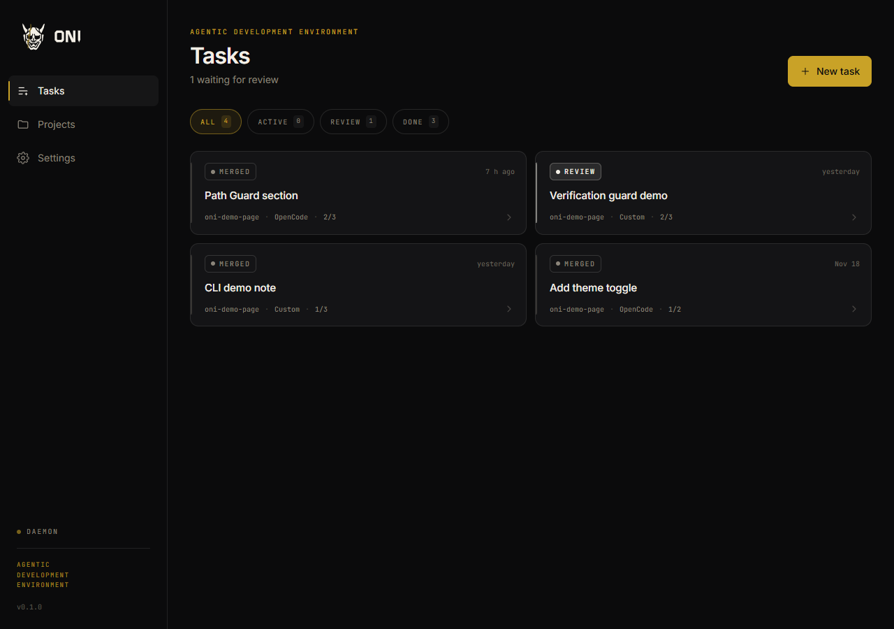

# ONI

**A local-first agentic development environment.** Oni runs coding agents in
disposable git worktrees, verifies every attempt, and leaves the merge decision
to you. Open source, MIT, no accounts and no cloud control plane.

[](https://github.com/Davoassassin27/oni/actions/workflows/ci.yml)
[](LICENSE)



**Status: v0.1.0, early. OpenCode is exercised end-to-end; Juniperus is
preview-only and no trained model weights are included.**

[Landing page](https://davoassassin27.github.io/oni/) ·
[Documentation](#docs) · [Juniperus](juniperus/)

## What is Oni

Oni is a supervision layer around CLI coding agents. The daemon runs on your
machine, creates one isolated worktree per task, streams the agent's output,
runs your verification command, retries with the failure output, and stops at a
review screen. You inspect the real patch and merge, retry, accept, or discard.

It is for developers who already use an agent such as OpenCode or Claude Code
and want the loop around it: isolation, verified attempts, a review gate, and a
way to supervise from a terminal or a phone.

## Why Oni

Running an agent directly in your checkout is fast until it edits the wrong
files, weakens a test, or leaves half a refactor behind. Oni adds the parts that
make that workflow repeatable:

- **A worktree per task.** Agents never write to the base branch. Every task gets
  an `oni/<slug>` branch and a disposable worktree.
- **Verification is a gate.** Your command must pass before review. Failures are
  fed back into the next attempt, within a bounded iteration and time budget.
- **The verifier is protected.** File-based verifiers are restored from the base
  branch, and changes to tests, CI, lockfiles, or configs require an explicit
  human acceptance before merge.
- **Merge is human.** Oni merges with `--no-ff` only when you ask. There is no
  auto-merge.
- **Three interfaces.** A terminal UI, a desktop/mobile PWA, and a scripting
  CLI over the same local API.
- **No SaaS.** No sign-up, seats, usage metering, hosted control plane, or
  analytics. The daemon talks to localhost.

Oni is not an editor, a cloud agent platform, a multi-agent DAG orchestrator,
or a filesystem sandbox. If you want a single interactive agent inside your
editor, use OpenCode, Claude Code, or Codex directly. Oni is the layer that
supervises their work.

## Requirements

- **Rust 1.88+**
- **Node 22+**
- **git**
- At least one agent CLI: **OpenCode** (tested), Claude Code (preset, untested),
  or a custom command that reads the prompt from stdin.
- Optional: **Python 3.11 + uv** for Juniperus.
- Optional: **TerminalTextEffects** (`tte`) for the TUI intro.

## Quick start

```bash
git clone https://github.com/Davoassassin27/oni
cd oni

# Build the PWA that gets embedded in the daemon, then start the daemon.
npm install
npm run build
cargo run --manifest-path oni-daemon/Cargo.toml
```

In a second terminal:

```bash
cargo install --path oni-daemon --bin oni --locked
oni
```

`oni` opens the terminal UI. The PWA is served by the daemon at
<http://127.0.0.1:7766>. Data lives in `~/.oni` (`C:\Users\<you>\.oni` on
Windows).

The TUI intro uses TerminalTextEffects when `tte` is available:

```bash
uv tool install terminaltexteffects
# or: pipx install terminaltexteffects
```

Skip it with `oni tui --no-intro` or `ONI_TUI_INTRO=0`.

### CLI

```bash
oni health
oni projects
oni tasks --state review
oni task <id-prefix>
oni log <id> --tail 40
oni new --project <project> --watch "add an FAQ section"
oni patch <id> --stat
oni accept <id>     # only when verification-sensitive files changed
oni merge <id>
oni stop <id>
oni discard <id>
```

`--url` / `ONI_URL`, `--token` / `ONI_TOKEN`, and `--json` are available for
scripting. Task IDs can be abbreviated to 8 characters.

### TUI

`oni` opens a Ratatui dashboard with a task list, detail, live log, unified
patch, and actions. Press `?` for keys. `:` or `/` opens the Juniperus command
palette and shows a preview decision without executing it.

See [`docs/TUI.md`](docs/TUI.md) for the full key map and layout.

## How it works

```text
task prompt
  → fresh worktree on oni/<slug>
  → agent runs headless with the prompt
  → acceptance command runs in the worktree
      fail → error is fed into the next attempt (bounded)
  → review: diff stat, files, unified patch, verification output
  → human: merge --no-ff, retry, accept verification changes, or discard
```

The daemon exposes REST + SSE, with no CORS. The PWA is same-origin and can be
embedded in the daemon binary; `ONI_PWA_DIR` serves a build from disk during
development.

## Juniperus

Juniperus is an optional local router. It turns a natural-language command into
a structured decision and returns it as a **preview**; the daemon validates and
sanitizes it, then shows it to you. It never creates tasks, merges, or kills
processes.

```bash
cd juniperus
uv sync --extra dev
uv run juniperus serve --backend mock --port 7767

# another terminal
export ONI_JUNIPERUS_URL=http://127.0.0.1:7767   # PowerShell: $env:...
oni route "mergeá la tarea 3f2a1b9c"
```

The deterministic fallback answers when the sidecar is missing or fails
(`source: fallback`). `main_direct` is always downgraded to an isolated branch.
The contract, dataset, LoRA/GGUF pipeline, sidecar, and bench live in
[`juniperus/`](juniperus/). The trained GGUF is not distributed here.

## Safety and data handling

- The daemon binds to `127.0.0.1` by default. LAN mode requires
  `ONI_HOST=0.0.0.0` and `ONI_TOKEN`.
- No CORS. The API is intended for the same-origin PWA.
- The token stays in the daemon environment and browser `localStorage`; it is
  never written to the repository.
- **Worktree isolation is Git-level, not a filesystem jail.** An agent runs
  with your permissions and can write outside its worktree using absolute paths
  or `..`; Oni will not see that in the diff. Use a container, WSL, or VM with
  restricted permissions for untrusted agents. See
  [`docs/SANDBOX.md`](docs/SANDBOX.md).
- Verification restores the file-based verifier from the base branch and flags
  test/CI/config changes, but review remains mandatory.

## Status

`v0.1.0` is an early release, not a finished product. The walking skeleton is
real: project → worktree → agent → verify → retry → review → merge/discard,
with a CLI, a TUI, and a desktop/mobile PWA.

Known gaps:

- OpenCode is exercised end-to-end; the Claude Code preset is implemented but
  not yet tested.
- Worktrees are Git isolation, not a filesystem sandbox. See
  [`docs/SANDBOX.md`](docs/SANDBOX.md).
- Juniperus ships the contract, mock/rules, pipeline, sidecar, and fallback;
  it does not ship trained GGUF weights.
- PWA install over LAN requires HTTPS (Tailscale Serve or a TLS proxy).
- CI runs on Linux; no Windows/macOS matrix yet.

## Docs

Most docs are in Spanish; issues and pull requests in English or Spanish are
welcome.

- [`docs/MVP.md`](docs/MVP.md) — scope, state machine, guardrails, roadmap.
- [`docs/TUI.md`](docs/TUI.md) — terminal UI keys and layout.
- [`docs/SANDBOX.md`](docs/SANDBOX.md) — isolation model and next steps.
- [`docs/BRAND.md`](docs/BRAND.md) — palette, type, wordmark rules.
- [`docs/DOGFOOD.md`](docs/DOGFOOD.md) — real runs, retries, stop/discard, path probe.
- [`juniperus/docs/CONTRACT.md`](juniperus/docs/CONTRACT.md) — router contract v1.
- [`site/`](site/) — the open-source landing page.

## Development

```bash
cargo test --manifest-path oni-daemon/Cargo.toml
cargo test --manifest-path oni-tui/Cargo.toml
npm run build

cd juniperus
uv sync --extra dev
uv run pytest
uv run ruff check .
```

CI runs Rust format/tests, the PWA build, the fake-agent smoke test, and the
Juniperus pytest/ruff/oracle bench on Linux.

## Contributing

Issues and focused pull requests are welcome. Run the tests listed above and
sign off commits with the DCO (`git commit -s`). See
[`CONTRIBUTING.md`](CONTRIBUTING.md). For vulnerabilities, use
[`SECURITY.md`](SECURITY.md), not a public issue.

## License and brand

Code and documentation are **MIT** ([`LICENSE`](LICENSE)). The Oni name,
wordmark, hannya mark, brand book, and visual assets are **not** covered by the
MIT license; see [`TRADEMARKS.md`](TRADEMARKS.md). The hannya symbol derives
from a Noun Project reference and needs licensing or a redraw before commercial
or trademark use; see [`THIRD_PARTY_NOTICES.md`](THIRD_PARTY_NOTICES.md).

Contributions are welcome under the DCO. See [`CONTRIBUTING.md`](CONTRIBUTING.md)
and [`SECURITY.md`](SECURITY.md).
